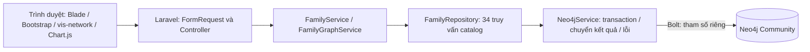
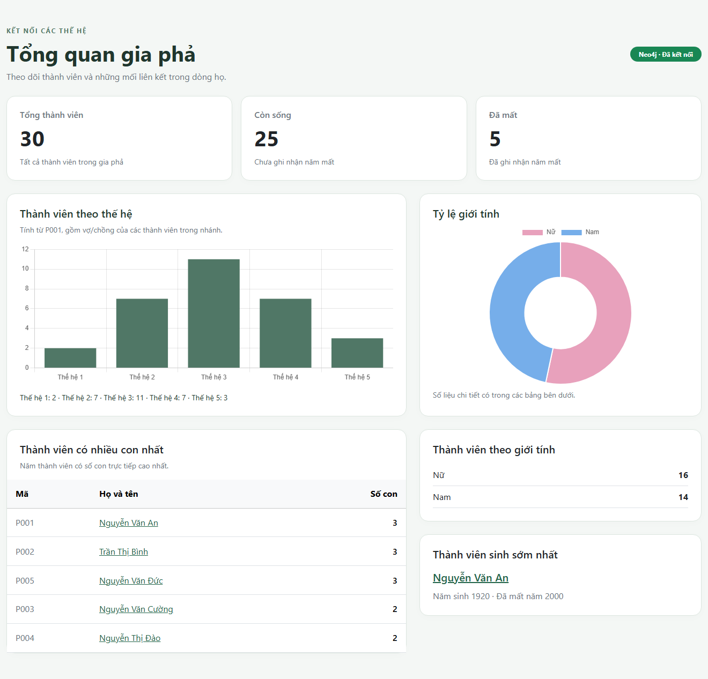
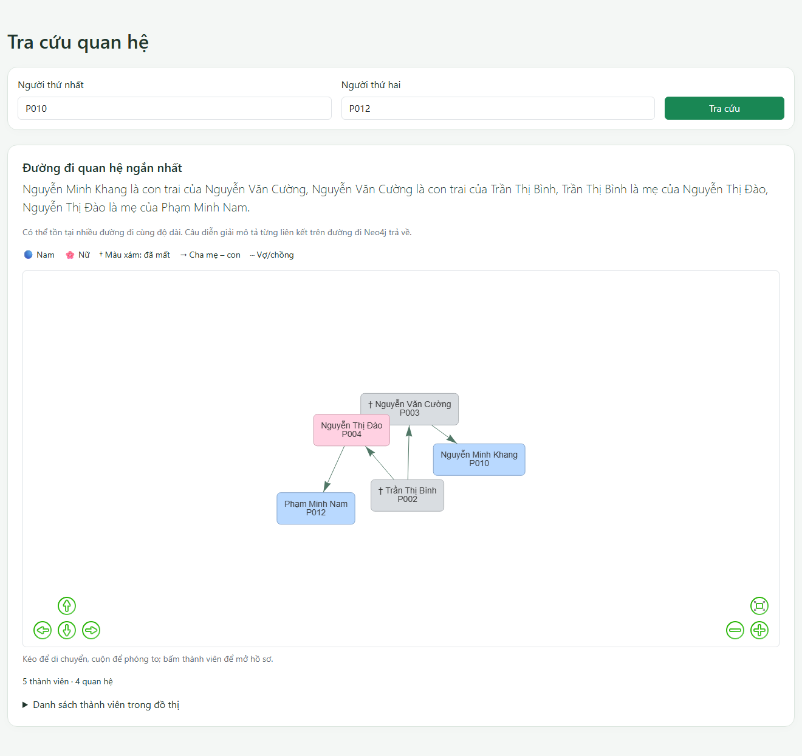

# Báo cáo ứng dụng gia phả Laravel – Neo4j

## Phạm vi và kiến trúc

Ứng dụng tiếp nối khung Laravel và catalog 34 truy vấn đã có trên main.
Nhánh app thay route placeholder bằng CRUD thành viên, quản lý quan hệ,
cây gia phả, tra cứu đường đi, biểu đồ Dashboard và tests với Neo4j thật.
Console/Admin và toàn bộ `neo4j/` được giữ nguyên.

- Đã kiểm tra Laravel **13.39.0**, PHP **8.3.30**, Laudis **3.7.1** trên máy.
- Dữ liệu nghiệp vụ ở Neo4j **5.26.31**; session/cache dùng tệp, queue đồng bộ.
- Bootstrap 5.3.8, vis-network 9.1.9, Chart.js 4.4.9 tải CDN; không cần Vite cho các trang này.
- Không thay dependencies, không tạo bảng SQL hay migrations.

## Tổ chức code

| Vị trí | Trách nhiệm |
| --- | --- |
| `app/Http/Requests/PersonRequest.php` | Validation, năm thành int, giá trị tùy chọn trống thành null |
| `app/Http/Requests/RelationshipRequest.php` | Kiểm tra ID và năm kết hôn |
| `PersonController`, `RelationshipController` | Nhận request, gọi service, trả view/redirect |
| `TreeController`, `RelationController` | Gốc/hai người và lỗi không tìm thấy |
| `FamilyService` | Quy tắc nghiệp vụ, khóa và transaction ghi |
| `FamilyGraphService` | Node/cạnh cho vis-network, tầng, câu diễn giải |
| `FamilyRepository` | 34 query và tham số theo catalog |
| `Neo4jService` | `run`, `client`, `transaction`, `ping`, `lastError`; chuyển đệ quy về mảng/scalar PHP |
| `bootstrap/app.php`, `resources/views/errors/neo4j.blade.php` | Lỗi DB thân thiện, HTML/JSON 503 |
| `resources/views/persons/` | Danh sách, form, hồ sơ, xác nhận xóa, partial link |
| `tests/Neo4jTestCase.php` | Fixture T_, dọn riêng T_, đối chiếu đồ thị gốc |

## Quy tắc dữ liệu

Chỉ lưu Person, PARENT_OF hướng cha/mẹ → con và SPOUSE_OF lưu một chiều nhưng tra cứu hai chiều.
Anh chị em, tổ tiên, hậu duệ và họ hàng được suy ra, không tạo cạnh riêng.

### Thành viên

- Tên bắt buộc, tối đa 100 ký tự; giới tính M/F.
- Năm sinh nguyên từ 1000 đến hiện tại; năm mất tùy chọn, không trước năm sinh hay sau hiện tại.
- Nơi sinh tối đa 100, ghi chú tối đa 500 ký tự.
- Ép năm thành int trước Cypher; ô tùy chọn trống thành null.
- Cấp ID bằng `sprintf('P%03d', maxPersonNumber + 1)` trong luồng ghi có khóa.
- Sửa năm sinh kiểm tra lại cha mẹ, con và năm kết hôn để không làm sai quan hệ hiện có.
- Trang xóa hiển thị relationshipCount; DETACH DELETE xóa người và cạnh, giữ những người khác.
- ID không tồn tại trả 404. Danh sách 10 dòng/trang, skip/limit là int.

### Cha mẹ – con

Cả hai tồn tại; không tự nhận cha mẹ; cạnh chưa tồn tại; con có dưới hai cha mẹ;
wouldCreateCycle phải false; khi có hai năm sinh, cha mẹ phải sinh **trước** con.
Không áp chênh tối thiểu 12 năm. Lệch một năm vẫn qua quy tắc kỹ thuật hiện tại.
Kiểm tra vòng lặp bảo vệ các truy vấn tổ tiên/hậu duệ trước chu trình cha mẹ.

### Vợ chồng

Cả hai tồn tại, khác nhau, chưa có cạnh theo cả hai chiều. Năm kết hôn tùy chọn là int,
không trước năm sinh của một trong hai người, không sau hiện tại.
Xóa quan hệ yêu cầu cả hai người và cạnh thực sự tồn tại; lỗi tiếng Việt.
Không tự thêm quy tắc cấm hôn nhân họ hàng hay giới hạn số vợ/chồng ngoài phạm vi prompt.

### Transaction và đồng thời

FamilyService::write giữ khóa tệp `family-write`, rồi gọi Neo4jService::transaction.
Helper dùng ClientInterface::writeTransaction đúng API Laudis 3.7.1;
mọi run của repository trong callback đi qua cùng TransactionInterface.
Lỗi validation rollback; finally trả runner về client.
Đã thử rollback trên Neo4j thật và kiểm tra cùng runner bằng mock driver.

Khóa tệp chỉ tuần tự hóa request ghi app trên một máy, không thay isolation nhiều máy chủ/client trực tiếp.
Admin reset dùng khóa bảo trì riêng; không reset hoặc ghi bằng Browser đồng thời với nhập liệu.
Constraint ID ở Neo4j vẫn bảo vệ tính duy nhất; quy tắc gia phả không phải constraint DB.

## Trang và truy vấn

Tên phương thức chính là tên trong `neo4j/queries.cypher`.

| Trang / hành động | Phương thức repository |
| --- | --- |
| `/` | statsByGender, statsByGeneration(P001), livingVsDeceased, topParents, oldestPerson |
| `/persons` | countPersons, searchPersons |
| Thêm người | maxPersonNumber, createPerson |
| Hồ sơ `/persons/{id}` | getPerson, parents, spouses, children, siblings, uncles, cousins, ancestors, descendants |
| Form sửa / lưu sửa | getPerson, parents, children, spouses, updatePerson |
| Xác nhận / xóa | getPerson, relationshipCount, deletePerson |
| Chọn người | countPersons, searchPersons |
| Thêm cha mẹ–con | getPerson, parentExists, parentCount, wouldCreateCycle, addParentOf |
| Xóa cha mẹ–con | getPerson, parentExists, removeParentOf |
| Thêm / xóa vợ chồng | getPerson, spouseExists, addSpouseOf / removeSpouseOf |
| `/tree`, `/api/tree` | getPerson, roots, subtree hoặc graphAll, generations |
| `/relation` | getPerson, relationPath; getPerson bổ sung giới tính từng node |

Không sửa Cypher nghiệp vụ. Input truyền qua mảng tham số riêng, không nối vào câu truy vấn.
Ngoài catalog chỉ có ping hạ tầng có sẵn và câu dọn fixture T_ mà prompt kiểm thử yêu cầu.

## Đồ thị và diễn giải

Gốc mặc định P001 nếu có, nếu không lấy người đầu từ roots; DB rỗng trả đồ thị rỗng.
subtree lấy nhánh và phối ngẫu; “Hiện toàn bộ” gọi graphAll.
Tầng lấy từ generations(root); nhóm nối bằng SPOUSE_OF được đặt cùng tầng.
Cha mẹ có mũi tên; vợ chồng nét đứt, không mũi tên, smooth=false.
Nam xanh, nữ hồng, người mất xám và †. Bấm node mở hồ sơ; có danh sách link thay thế canvas.

relationPath chỉ trả ID/tên nên app tải giới tính bằng getPerson.
relFrom là ID đầu cạnh **được lưu**, không phải thứ tự đang đi trên path:

- PARENT_OF cùng chiều: A là cha/mẹ của B theo giới tính A.
- PARENT_OF ngược chiều: A là con trai/con gái của B theo giới tính A.
- SPOUSE_OF: A là chồng/vợ của B theo giới tính A.

Nối các mệnh đề bằng dấu phẩy, kết thúc dấu chấm; không tự đặt nhãn như “bác họ”.
Cùng ID: “Đây là cùng một người”; không có path: không có quan hệ trong gia phả.
Path bằng độ dài có thể khác nhau; test không giả định cách phá hòa cụ thể.

## Kiểm chứng thực tế

Lần kiểm tra ngày **03/11/2026 (Asia/Saigon)**: `php artisan test --compact` đạt **95 tests / 650 assertions**.
Pint toàn dự án, Composer validate/platform requirements đều đạt; routes không còn placeholder.
Sau test, đối chiếu toàn bộ seed với CSV: **30 người / 36 PARENT_OF / 11 SPOUSE_OF**,
đúng mọi thuộc tính và cạnh, **0 người T_ còn lại**.
Chi tiết máy đọc được: [app-verification.json](app-verification.json).

FamilyRepositoryContractTest đối chiếu nguyên văn 34 query và tham số.
`check_queries.py` tạm **ngoài repo** đối chiếu normalized text: **34 OK, mismatches: 0**.
Integration tests chỉ ghi người T_, không đụng P001–P030; sau mỗi test so sánh toàn bộ
node/property/cạnh gốc. Test HTTP cấp P031 dùng mock để tránh ghi mã P vào seed.

Đã thử CRUD, integer/null, XSS tên, tự nhận cha mẹ, cha mẹ thứ ba, vòng lặp, năm sinh sai,
trùng cha mẹ, trùng vợ chồng chiều ngược, năm kết hôn sai, xóa cạnh không tồn tại,
rollback, cây rỗng/thiếu P001, ID không tồn tại, same-person/no-path, hướng câu diễn giải,
lỗi Neo4j và bộ test Console/Admin đã có.

Mẫu: anh chị em P014 = **P015, P016**; anh chị em họ P010 = **P012–P016**.
Toàn bộ **30 node, 47 cạnh**; nhánh P010 **7 node, 10 cạnh**.
Thế hệ từ P001 **2, 7, 11, 7, 3**; nam/nữ **14/16**; còn sống/đã mất **25/5**.

## Ảnh thật và danh sách chụp lại khi demo

Ảnh chụp từ phiên Edge kiểm thử local nối Neo4j thật, không phải ảnh dựng.

| Ảnh | Điểm cần thấy |
| --- | --- |
| [Dashboard](screenshots/app-dashboard.png) | 30 người; biểu đồ thế hệ và giới tính |
| [P014](screenshots/app-person-p014.png) | Anh chị em P015, P016 và nhóm họ hàng |
| [Cây](screenshots/app-tree.png) | 30 node, 47 cạnh, màu/nét đứt |
| [P010 → P012](screenshots/app-relation-p010-p012.png) | Diễn giải đúng từng liên kết |
| [Quan hệ](screenshots/app-relationships.png) | Bốn form thêm/xóa |
| [Tự nhận cha mẹ](screenshots/app-invalid-self-parent.png) | Lỗi tiếng Việt sau form có CSRF thật |

Nên chụp thêm form tạo/sửa/xác nhận xóa với người thử, lỗi cha mẹ thứ ba/vòng lặp/năm sinh
và kết quả test terminal. Không dùng dữ liệu cá nhân thật.

## Hạn chế

- Tìm tên chưa bỏ dấu, có gợi ý “gõ có dấu”.
- Chưa có đăng nhập/phân quyền app. Community không có RBAC; Console chỉ lọc từ khóa.
- Client trực tiếp/Browser/Admin reset có thể bỏ qua quy tắc app.
- Khóa tệp chỉ dùng chung trên một máy; ID max+1 có thể dùng lại mã cao nhất đã xóa.
- Người ngoài nhánh thế hệ đã chọn có thể ở tầng gốc trong cây toàn bộ;
  đây là bố cục hiển thị, không tạo thêm huyết thống vào DB.
- CDN cần Internet; mất thư viện vẫn có bảng/danh sách link và thông báo.
- Chỉ kiểm chứng seed 30 người; chưa chứng minh hiệu năng gia phả lớn.
- **Docker chưa được kiểm thử trên máy này**; các số liệu dùng Neo4j native 5.26.31.
- Không khẳng định đã chạy backup/dump hoặc clean-clone Docker.

API hiển thị: [vis-network](https://visjs.github.io/vis-network/docs/network/),
[Chart.js integration](https://www.chartjs.org/docs/latest/getting-started/integration.html).
