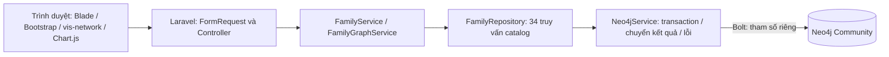
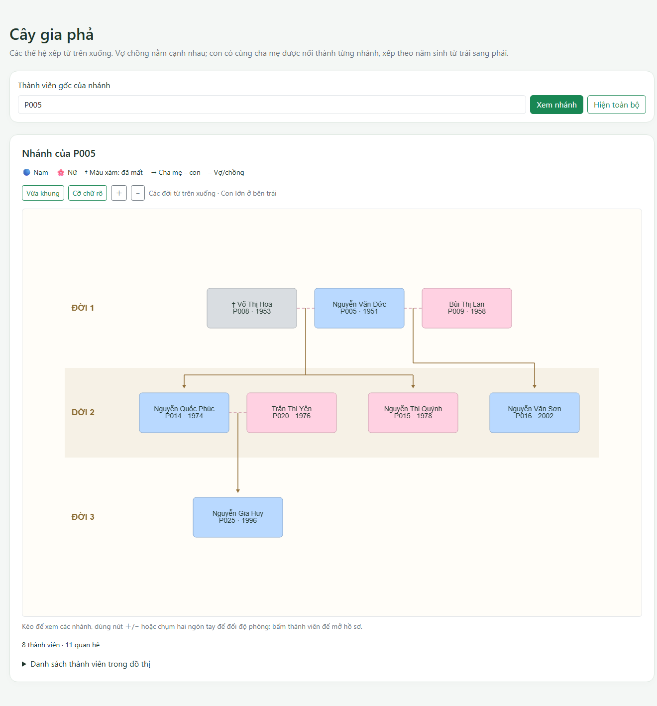

# Báo cáo ứng dụng gia phả Laravel – Neo4j

## Phạm vi và kiến trúc

Ứng dụng tiếp nối khung Laravel và catalog 34 truy vấn đã có trên main.
Nhánh app thay route placeholder bằng CRUD thành viên, quản lý quan hệ,
cây gia phả, tra cứu đường đi, biểu đồ Dashboard và tests với Neo4j thật.
Catalog, schema và seed chuẩn giữ nguyên. Cypher Console đã được gỡ theo yêu cầu;
Admin có schema, PROFILE, reset local và sao lưu/khôi phục gia phả JSON.
Lượt sửa ngày 05/11/2026 được ghi riêng trong [review-fixes.md](review-fixes.md).

- Đã kiểm tra Laravel **13.39.0**, PHP **8.3.30**, Laudis **3.7.1** trên máy.
- Dữ liệu nghiệp vụ ở Neo4j **5.26.31**; session/cache dùng tệp, queue đồng bộ.
- Bootstrap 5.3.8, vis-network 9.1.9, Chart.js 4.4.9 tải CDN; không cần Vite cho các trang này.
- Không thay dependencies, không tạo bảng SQL hay migrations.

## Tổ chức code

| Vị trí | Trách nhiệm |
| --- | --- |
| `app/Http/Requests/PersonRequest.php` | Validation, năm thành int, giá trị tùy chọn trống thành null |
| `app/Http/Requests/RelationshipRequest.php` | Kiểm tra ID và năm kết hôn |
| `PersonController`, `RelationshipController` | Nhận request, gọi service, trả view/redirect |
| `TreeController`, `RelationController` | Gốc/hai người và lỗi không tìm thấy |
| `FamilyService` | Quy tắc nghiệp vụ, khóa và transaction ghi |
| `FamilyRelationshipPolicy` | Quy tắc năm và huyết thống dùng chung với import JSON |
| `GraphWriteLock` | Singleton khóa OS dùng chung ghi nghiệp vụ và bảo trì |
| `FamilyBackupService`, `RestoreBackupRequest` | Backup/restore JSON, bản an toàn, validation |
| `FamilyGraphService` | Node/cạnh cho vis-network, tầng, câu diễn giải |
| `FamilyTreeLayout` | Khối gia đình, thứ tự nhánh/năm sinh, tọa độ cố định |
| `CypherStatements` | Parser tách câu schema/seed cho Admin và seeder Neo4j |
| `FamilyRepository` | 34 query và tham số theo catalog |
| `Neo4jService` | `run`, `client`, `transaction`, `ping`, `lastError`; chuyển đệ quy về mảng/scalar PHP |
| `bootstrap/app.php`, `resources/views/errors/neo4j.blade.php` | Lỗi DB thân thiện, HTML/JSON 503 |
| `resources/views/persons/` | Danh sách, form, hồ sơ, xác nhận xóa, partial link |
| `tests/Neo4jTestCase.php` | Chặn integration khi chưa bật cờ DB riêng; đối chiếu graph gốc |

## Quy tắc dữ liệu

Chỉ lưu Person, PARENT_OF hướng cha/mẹ → con và SPOUSE_OF lưu một chiều nhưng tra cứu hai chiều.
Anh chị em, tổ tiên, hậu duệ và họ hàng được suy ra, không tạo cạnh riêng.

### Thành viên

- Tên bắt buộc, tối đa 100 ký tự; giới tính M/F.
- Năm sinh nguyên từ 1000 đến hiện tại; năm mất tùy chọn, không trước năm sinh hay sau hiện tại.
- Nơi sinh tối đa 100, ghi chú tối đa 500 ký tự.
- Ép năm thành int trước Cypher; ô tùy chọn trống thành null.
- Cấp ID bằng `sprintf('P%03d', maxPersonNumber + 1)` trong luồng ghi có khóa.
- Sửa năm sinh/mất/giới tính kiểm tra lại cha mẹ, con và hôn nhân; lỗi không lưu một phần hồ sơ.
- Trang xóa hiển thị relationshipCount; DETACH DELETE xóa người và cạnh, giữ những người khác.
- ID không tồn tại trả 404. Danh sách 10 dòng/trang, skip/limit là int.

### Cha mẹ – con

Cả hai tồn tại; không tự nhận cha mẹ; cạnh chưa tồn tại; con có dưới hai cha mẹ;
wouldCreateCycle phải false; khi có hai năm sinh, cha mẹ phải sinh **trước** con.
Không áp chênh tối thiểu 12 năm. Lệch một năm vẫn qua quy tắc kỹ thuật hiện tại.
Kiểm tra vòng lặp bảo vệ các truy vấn tổ tiên/hậu duệ trước chu trình cha mẹ.

Trong phạm vi đồ án, `PARENT_OF` biểu diễn cha mẹ sinh học, chưa phân biệt cha mẹ nuôi.
Nếu biết năm mất, mẹ phải có `child.birthYear <= mother.deathYear`; cha cho phép
`child.birthYear <= father.deathYear + 1`. Dung sai một năm là lựa chọn mô hình hóa
dữ liệu theo năm, không phải khẳng định y khoa/pháp luật. Không suy diễn năm mất khi thiếu.
Ví dụ mẹ sinh 1950/mất 1980 không thể thêm con sinh 2000; cha mất 2000 có thể có con
sinh 2001 theo quy ước demo, nhưng con sinh 2002 bị chặn.

### Vợ chồng

Cả hai tồn tại, khác nhau, chưa có cạnh theo cả hai chiều. Năm kết hôn tùy chọn là int,
không trước năm sinh của một trong hai người, không sau hiện tại hay năm mất đã biết
của bất kỳ người nào. Cùng năm mất hoặc thiếu năm kết hôn vẫn được chấp nhận.
Xóa quan hệ yêu cầu cả hai người và cạnh thực sự tồn tại; lỗi tiếng Việt.

Chặn tổ tiên–hậu duệ và anh chị em chung ít nhất một cha/mẹ; không mở rộng cấm anh
em họ hay giới hạn số phối ngẫu. Thêm cạnh cha mẹ cũng kiểm tra chiều ngược: cạnh
trực tiếp hoặc trung gian không được làm một cặp phối ngẫu hiện có trở thành anh
chị em/tổ tiên–hậu duệ. Kiểm tra và ghi cùng transaction/khóa; tạo người kèm quan
hệ sai rollback cả người mới và các cạnh đã thêm trong thao tác đó.

### Transaction và đồng thời

FamilyService, seeder, reset, PROFILE thay index, backup và restore dùng cùng singleton
`GraphWriteLock`. Khóa OS `flock` ở `storage/framework/cache/graph-write.lock`, chờ
tối đa 5 giây mặc định, giữ đến khi callback xong/lỗi hoặc process kết thúc; không
có TTL làm hết khóa giữa chừng. Callback lồng cùng singleton dùng quyền giữ khóa
hiện có. Không xóa/đổi tệp khóa trong lúc app đang chạy.

`Neo4jService::transaction()` gọi `beginTransaction`, `commit`, `rollback` tường minh;
mọi `run` trong callback dùng cùng runner, `finally` trả runner về client. Admin
reset dùng helper này cho xóa và nạp seed; lỗi giữa chừng hoàn tác graph. Schema
IF NOT EXISTS chạy riêng; PROFILE phục hồi `person_name` trong `finally` kể cả lỗi.
Đã kiểm thử rollback trên Neo4j thật, request sau lỗi và tranh khóa bằng hai process
đồng bộ stdout/stdin, không dựa vào sleep ngẫu nhiên để kết luận hết race.

Khóa chỉ bảo vệ các process app dùng cùng tệp trên một máy. Client Bolt trực tiếp
hoặc nhiều máy chủ không chia sẻ khóa cần cơ chế khác.
Constraint ID ở Neo4j vẫn bảo vệ tính duy nhất; quy tắc gia phả không phải constraint DB.

## Trang và truy vấn

Tên phương thức chính là tên trong `neo4j/queries.cypher`.

| Trang / hành động | Phương thức repository |
| --- | --- |
| `/?root={id}` | statsByGender, statsByGeneration(gốc đã chọn), livingVsDeceased, topParents, oldestPerson |
| `/persons` | countPersons, searchPersons |
| Thêm người | maxPersonNumber, createPerson |
| Hồ sơ `/persons/{id}` | getPerson, parents, spouses, children, siblings, uncles, cousins, ancestors, descendants |
| Form sửa / lưu sửa | getPerson, parents, children, spouses, updatePerson |
| Xác nhận / xóa | getPerson, relationshipCount, deletePerson |
| Chọn người | countPersons, searchPersons |
| Thêm cha mẹ–con | getPerson, parentExists, parentCount, wouldCreateCycle, addParentOf |
| Xóa cha mẹ–con | getPerson, parentExists, removeParentOf |
| Thêm / xóa vợ chồng | getPerson, spouseExists, addSpouseOf / removeSpouseOf |
| `/tree`, `/api/tree` | getPerson, roots, subtree hoặc graphAll, generations |
| `/relation` | getPerson, relationPath; getPerson bổ sung giới tính từng node |

Giữ nguyên 34 query và tham số trong catalog/FamilyRepository. Kiểm tra huyết thống
bổ sung trong FamilyService dùng Cypher có tham số, tách khỏi catalog cố định.
Admin có SHOW, thống kê schema, PROFILE, backup/restore và schema/seed riêng.
Không nối input vào Cypher. Ping hạ tầng và dọn fixture cũng ngoài catalog.

Dashboard cho chọn gốc, ưu tiên P001 nếu chưa chọn rồi fallback người từ roots.
Gốc yêu cầu không tồn tại trả 404, DB rỗng hiển thị trạng thái trống. Tổng thành viên,
giới tính, sống/mất, top cha mẹ và người cao tuổi thuộc toàn graph; chỉ biểu đồ thế
hệ theo nhánh đã chọn. P010 có 2/3/2 người (7), dù toàn graph có 30 người.

## Sao lưu và khôi phục trong Admin

Ở `/admin#backup-restore`, tạo/tải JSON chứa Person và hai loại cạnh, tải lại 10 bản
gần nhất; restore yêu cầu tệp tối đa 10 MB và xác nhận thay toàn bộ gia phả. Dữ liệu
được kiểm tra checksum, kiểu, ID, endpoint, cạnh trùng, chu trình, số cha mẹ và các
quy tắc năm/huyết thống trước ghi. Giới hạn nhận 20.000 người/100.000 cạnh chưa phải
bằng chứng hiệu năng xử lý/UI ở mức đó.

App lưu snapshot an toàn trước khi thay graph; lưu không thành công thì không xóa.
DELETE/CREATE/đối chiếu snapshot diễn ra trong một transaction, lỗi sẽ rollback.
Tệp ở storage private, UUID tải được validate, không dùng đường dẫn input tùy ý.
Chỉ hiển thị 10 bản gần nhất, chưa có retention tự xóa. Graph ngoài hợp đồng hoặc
dữ liệu cũ không hợp lệ bị từ chối, không tự sửa dữ liệu.

Đây là backup logic gia phả, không chứa tài khoản, cấu hình hoặc custom schema;
restore áp dụng schema chuẩn dự án. Dump nhị phân Community là luồng offline riêng
đã có bằng chứng delivery cũ; dump gia phả không bao gồm user/role database `system`.
Các route bảo trì vẫn giới hạn `local` ở server; điều này không thay đăng nhập/phân quyền.

## Đồ thị và diễn giải

Gốc mặc định P001 nếu có, nếu không lấy người đầu từ roots; DB rỗng trả đồ thị rỗng.
subtree lấy nhánh và phối ngẫu; “Hiện toàn bộ” gọi graphAll.
Tầng tham khảo generations(root), sau đó bố trí các nhóm cha mẹ/vợ chồng thành từng khối.
Mỗi nhánh dành sẵn đủ bề rộng cho hậu duệ; anh chị em xếp theo năm sinh rồi ID.
Các con có **đúng cùng tập cha mẹ** mới chung một thanh nhánh; P005/P008 có P014, P015, còn P005/P009 có P016.
Điểm nối và đường gấp khúc chỉ thuộc phần vẽ, không tạo node/cạnh mới trong Neo4j.
Tọa độ cố định và tắt physics cho cây nên đổi kích thước cửa sổ không xáo trộn thứ tự.
Với hôn nhân nối hai nhánh, chọn một nhánh chính để dành chỗ nhưng vẫn vẽ đủ mọi quan hệ cha mẹ thật.
Cha mẹ có mũi tên; vợ chồng nét đứt, không mũi tên, smooth=false.
Có nhãn ĐỜI, nút vừa khung/cỡ chữ rõ/zoom; mobile mở vào gia đình gốc để giữ tên dễ đọc.
Tọa độ hiển thị tính lại từ các quan hệ hiện có, không lưu ngược vào dữ liệu Person.
Nam xanh, nữ hồng, người mất xám và †. Trên cây, bấm node chọn người để thêm người
thân, bấm đúp mở hồ sơ; đồ thị đường quan hệ mở hồ sơ khi bấm node. Có link thay canvas.

relationPath chỉ trả ID/tên nên app tải giới tính bằng getPerson.
relFrom là ID đầu cạnh **được lưu**, không phải thứ tự đang đi trên path:

- PARENT_OF cùng chiều: A là cha/mẹ của B theo giới tính A.
- PARENT_OF ngược chiều: A là con trai/con gái của B theo giới tính A.
- SPOUSE_OF: A là chồng/vợ của B theo giới tính A.

Nối các mệnh đề bằng dấu phẩy, kết thúc dấu chấm; không tự đặt nhãn như “bác họ”.
Cùng ID: “Đây là cùng một người”; không có path: không có quan hệ trong gia phả.
Path bằng độ dài có thể khác nhau; test không giả định cách phá hòa cụ thể.

## Kiểm chứng thực tế

Các lần đo được giữ riêng, không thay timestamp/SHA/số liệu cũ:

| Lượt | Nguồn và phạm vi |
| --- | --- |
| 03/11/2026 | [app-verification.json](app-verification.json): native, 49 tests / 752 assertions |
| Delivery mã `d448211` | [delivery-verification.json](delivery-verification.json): 58 tests / 820 assertions, Docker/clone Git cục bộ/dump-load thật và query 20.000 người |
| Sửa bàn giao 05/11/2026 | [review-fixes-verification.json](review-fixes-verification.json): mã `273ee59`, native cô lập, **92 tests / 1190 assertions**, 3 JS tests; kiểm tra UI mới qua trình duyệt |

Lượt mới so toàn graph trước/sau và CSV: **30 / 36 / 11**, mọi thuộc tính/cạnh khớp,
0 T_, name index ONLINE. `FamilyRepositoryContractTest` vẫn đối chiếu đủ 34 query.
Tests thường dùng fixture T_; test restore/reset thực sự thay/xóa graph **chỉ trên
instance kiểm thử riêng**, rồi hoàn trả graph gốc. Không chạy trên DB người dùng.
Thiếu cờ xác nhận DB kiểm thử thì integration skip trước kết nối. Xem lệnh tại README.
Lượt mới không chạy lại Docker, dump nhị phân, benchmark 20.000 người hoặc browser
export SVG/PNG/PDF; máy không có Docker CLI. Giữ kết quả delivery làm bằng chứng lịch sử.

Đã thử CRUD, integer/null, XSS tên, tự nhận cha mẹ, cha mẹ thứ ba, vòng lặp, năm sinh sai,
trùng cha mẹ, trùng vợ chồng chiều ngược, năm kết hôn sai, xóa cạnh không tồn tại,
rollback, cây rỗng/thiếu P001, ID không tồn tại, same-person/no-path, hướng câu diễn giải,
lỗi Neo4j, Admin và việc các endpoint Console đã được gỡ.

Mẫu: anh chị em P014 = **P015, P016**; anh chị em họ P010 = **P012–P016**.
Toàn bộ **30 node, 47 cạnh**; nhánh P010 **7 node, 10 cạnh**.
Thế hệ từ P001 **2, 7, 11, 7, 3**; nam/nữ **14/16**; còn sống/đã mất **25/5**.

## Ảnh thật và danh sách chụp lại khi demo

Các ảnh PNG dưới đây thuộc phiên Edge cũ nối Neo4j thật. Ảnh JPEG mới ngày 05/11
được chụp qua trình duyệt kiểm tra native, dùng cho tính năng mới:

- [Admin sao lưu/khôi phục trên điện thoại](screenshots/admin-backup-restore-phone.jpg).
- [Dashboard chọn P010 trên điện thoại](screenshots/dashboard-root-phone.jpg).

Lượt mới kiểm tra kích thước desktop/tablet/phone bằng DOM: không tràn ngang trang;
bảng rộng trên Admin có thanh cuộn trong vùng bảng. Không dùng ảnh cũ làm bằng chứng UI mới.

| Ảnh | Điểm cần thấy |
| --- | --- |
| [Dashboard](screenshots/app-dashboard.png) | 30 người; biểu đồ thế hệ và giới tính |
| [P014](screenshots/app-person-p014.png) | Anh chị em P015, P016 và nhóm họ hàng |
| [Cây](screenshots/app-tree.png) | 30 node, 47 cạnh, màu/nét đứt |
| [Cây trên tablet](screenshots/app-tree-tablet.png) | Viewport 820px, thẻ không chồng nhau, menu thu gọn |
| [Cây trên điện thoại](screenshots/app-tree-phone.png) | Viewport 390px, kéo/zoom xem các nhánh, không tràn ngang trang |
| [Hai hôn nhân P005](screenshots/app-tree-two-marriages.png) | P014/P015 nối P005–P008; P016 nối P005–P009 |
| [P010 → P012](screenshots/app-relation-p010-p012.png) | Diễn giải đúng từng liên kết |
| [Quan hệ](screenshots/app-relationships.png) | Bốn form thêm/xóa |
| [Tự nhận cha mẹ](screenshots/app-invalid-self-parent.png) | Lỗi tiếng Việt sau form có CSRF thật |

Nên chụp thêm form tạo/sửa/xác nhận xóa với người thử, lỗi cha mẹ thứ ba/vòng lặp/năm sinh
và kết quả test terminal. Không dùng dữ liệu cá nhân thật.

## Hạn chế

- Tìm tên chưa bỏ dấu, có gợi ý “gõ có dấu”.
- Chưa có đăng nhập/phân quyền app. Community không có RBAC. Không còn trang nhập Cypher tùy ý trong ứng dụng.
- Client trực tiếp/Browser có thể bỏ qua quy tắc app; reset nạp fixture chuẩn và cần xác nhận local.
- Khóa tệp chỉ dùng chung trên một máy; ID max+1 có thể dùng lại mã cao nhất đã xóa.
- Dữ liệu chỉ có năm; quy ước cha/mẹ sinh học chưa biểu diễn cha mẹ nuôi hoặc ngày tháng cụ thể.
- Chưa audit toàn bộ dữ liệu cũ; validation mới chỉ chặn các thao tác liên quan sau sửa.
- Các cây rời được đặt thành từng cụm. Hôn nhân nối hai nhánh có thể cần đường nối dài; mọi quan hệ thật vẫn được giữ.
  Bố cục không tạo thêm huyết thống hoặc suy diễn hôn nhân khi hai người chỉ cùng làm cha mẹ.
- CDN cần Internet; mất thư viện vẫn có bảng/danh sách link và thông báo.
- Dataset 20.000 người kiểm chứng query tổng hợp tại delivery, chưa chứng minh UI
  render/export toàn bộ 20.000 người; choices vẫn tải toàn bộ danh sách.
- Giảm DB hits không đồng nghĩa tăng tốc thời gian tương ứng. Không dùng CONTAINS làm equality index demo.
- Clone sạch delivery là từ repo Git cục bộ, không chứng minh clone trực tiếp GitHub.
- Lượt mới chỉ native 5.26.31 và JSON restore trên DB cô lập; chưa chạy lại Docker/dump
  nhị phân trên mã sửa mới. Artifact nhị phân delivery trên máy cũ không mặc nhiên có trong repo này.

Cách bố trí gia đình tham khảo mô hình [family nodes của yWorks](https://kb.yworks.com/article/703/index.html), tự triển khai phần bố trí, không cài thêm thư viện.
API hiển thị: [vis-network](https://visjs.github.io/vis-network/docs/network/),
[Chart.js integration](https://www.chartjs.org/docs/latest/getting-started/integration.html).
