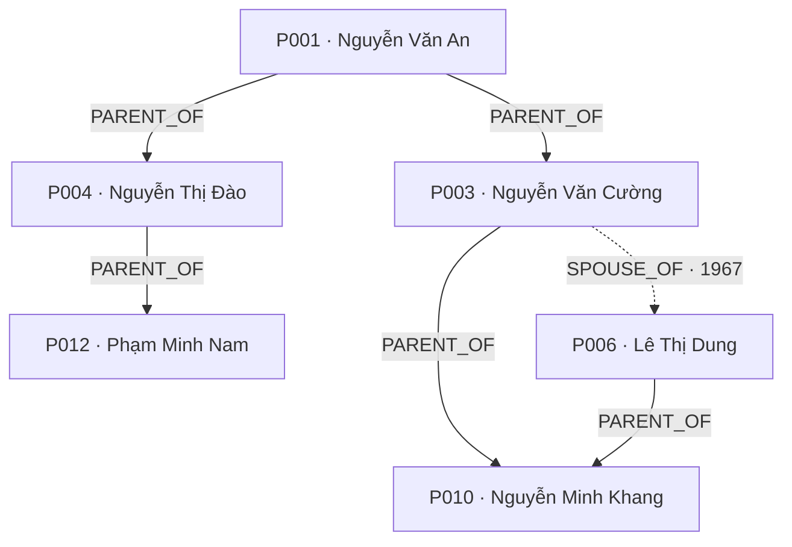
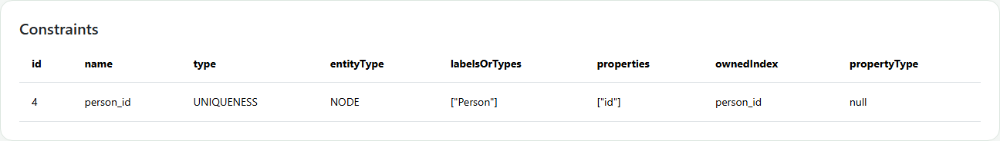
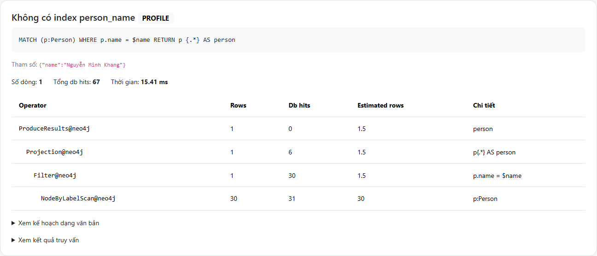
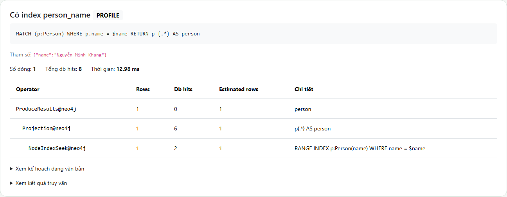
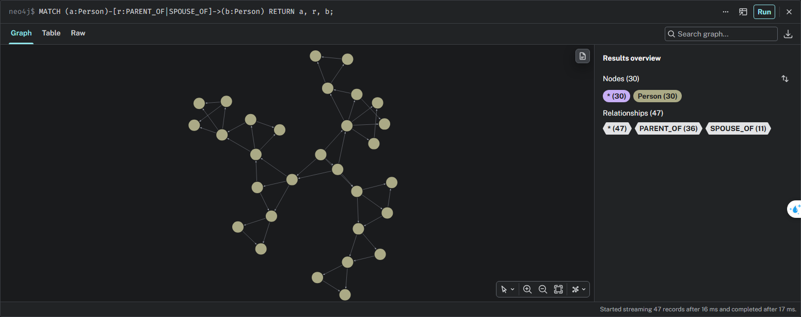

# Neo4j và Cypher trong quản lý gia phả — báo cáo cơ sở dữ liệu của A

## 1. Phạm vi và nguồn số liệu

Báo cáo trình bày mô hình dữ liệu, truy vấn Cypher, quản trị và kiểm chứng phần DB
của đồ án quản lý gia phả. Code nền dùng để đo ở commit `993b129`, sau khi hợp nhất
mốc 2 qua PR #3. Ở phiên bản ứng dụng hiện tại, Cypher Console đã được gỡ theo yêu cầu;
trang `/admin` tiếp tục cung cấp schema, PROFILE và reset demo local.
Chức năng ứng dụng hiện tại được mô tả trong [báo cáo app](report-app.md).

Số liệu dưới đây được lấy từ những lần chạy thật, không lấy số minh họa của tài liệu:

| Thành phần | Môi trường đã chạy |
| --- | --- |
| Neo4j | 5.26.31 Community, database `neo4j` |
| Java | 17 |
| Laravel / PHP | 13.39.0 / 8.3.30 |
| PHP client | `laudis/neo4j-php-client` 3.7.1, kết nối Bolt |
| Dữ liệu | Dòng họ Nguyễn hư cấu, P001–P030 |
| Số nút / cạnh | 30 `Person`; 36 `PARENT_OF`; 11 `SPOUSE_OF` |
| Giới tính / tình trạng | 14 nam, 16 nữ; 25 còn sống, 5 đã mất |
| Thế hệ từ P001 | 5 thế hệ, lần lượt 2, 7, 11, 7, 3 người |
| Kiểm thử Laravel ở mốc 2 | 72 test, 318 assertions đạt |
| Kiểm thử ứng dụng hiện tại | 49 test, 752 assertions đạt; Console đã gỡ |

Mốc 3 đã chạy lại **đủ 34 truy vấn** để xuất ví dụ. Các ví dụ ghi dùng P901–P903
trong giao dịch và đã rollback; toàn bộ graph sau phép thử được so sánh với snapshot
ban đầu. PROFILE được chạy lại qua trang Admin thật. Nguồn kiểm chứng:

- [Đầu ra 34 truy vấn](../neo4j/evidence/query-samples.json), kèm tham số và hash catalog.
- [Schema, index, số lượng và kiểm tra chu trình](../neo4j/evidence/schema-and-counts.json).
- [Số liệu PROFILE đo lại](../neo4j/evidence/profile-comparison.json) và [EXPLAIN thật](../neo4j/evidence/explain-plan.json).
- [Kết quả SQL đối chiếu](../neo4j/evidence/sql-comparison.json).
- [Kiểm chứng mốc 1](../neo4j/verify.md) và [kiểm chứng mốc 2](../neo4j/verify-m2.md).

Docker chưa được kiểm thử trên máy này vì chưa có Docker. Các kết quả thực thi là
của bản Neo4j native trong vùng dữ liệu demo riêng. Không suy ra rằng kiểm thử native
đã chứng minh cấu hình container chạy thành công.

## 2. Neo4j và mô hình property graph

Neo4j lưu dữ liệu dưới dạng đồ thị thuộc tính: node biểu diễn thực thể, relationship
biểu diễn liên kết có hướng; node và relationship có thể mang thuộc tính. Label phân
loại node, relationship type mô tả ý nghĩa liên kết. Cypher là ngôn ngữ khai báo:
người viết mô tả mẫu cần tìm, bộ lập kế hoạch chọn cách thực thi.
Community hỗ trợ các chức năng graph, Cypher và giao dịch ACID phục vụ demo này.
[Giới thiệu các edition của Neo4j](https://neo4j.com/docs/operations-manual/current/introduction/)

Gia phả phù hợp để khảo sát truy vấn graph vì câu hỏi thường đi qua nhiều mức quan hệ:
cha mẹ, anh chị em, tổ tiên, hậu duệ và đường nối hai thành viên. SQL cũng giải được
các câu hỏi đó; mục tiêu đồ án là đánh giá cách biểu diễn và truy vấn, không khẳng định
Neo4j luôn nhanh hơn mọi mô hình SQL.

## 3. Mô hình gia phả và dữ liệu mẫu

### 3.1. Node và thuộc tính

Chỉ dùng label `Person`:

| Thuộc tính | Kiểu và ý nghĩa theo hợp đồng ứng dụng |
| --- | --- |
| `id` | String duy nhất, ví dụ P001 |
| `name` | Tên tiếng Việt |
| `gender` | String `M` hoặc `F` |
| `birthYear` | Integer, năm sinh |
| `deathYear` | Integer hoặc null; không có giá trị nghĩa là chưa ghi nhận mất |
| `birthPlace` | String hoặc null |
| `note` | String hoặc null |

Trong Neo4j, gán null sẽ bỏ thuộc tính khỏi node. Vì vậy `p {.*}` có thể thiếu các
khóa tùy chọn; không nên yêu cầu mọi map luôn có đủ bảy khóa. CSV dùng ô rỗng cho
giá trị tùy chọn và loader chuyển chúng thành null. Năm sinh/năm mất được chuyển
thành integer, không giữ nguyên chuỗi CSV.

### 3.2. Hai loại relationship

- `(parent)-[:PARENT_OF]->(child)`: luôn lưu từ cha/mẹ đến con.
- `(a)-[:SPOUSE_OF {marriageYear}]->(b)`: mỗi cặp chỉ có một cạnh được lưu;
  các thao tác tìm/kiểm tra/xóa hôn nhân dùng mẫu vô hướng `-[:SPOUSE_OF]-`.

Ví dụ một phần dữ liệu thật:



Đây là phần trích để đọc mô hình, không phải toàn bộ 30 người. Mũi tên hôn nhân
chỉ biểu diễn hướng cạnh được lưu, không biểu diễn vai vế.

### 3.3. Vì sao không lưu SIBLING, UNCLE, COUSIN hay GENERATION?

Các quan hệ này suy ra từ cạnh cơ sở. Nếu lưu thêm, mỗi lần sửa cha/mẹ phải cập nhật
nhiều quan hệ phụ và dễ tạo mâu thuẫn. Trong code hiện tại:

- Anh chị em có ít nhất một cha/mẹ chung; P014 có P015 và P016, trong đó P016 cùng cha khác mẹ.
- Chú bác cô dì là anh chị em của cha hoặc mẹ, gồm cả hai giới; không tự thêm phối ngẫu của họ.
- Anh em họ là con của các cha/mẹ có quan hệ anh chị em; loại người đó và anh chị em của họ.
- `DISTINCT` loại bản ghi trùng khi có nhiều đường qua cả ông và bà.
- Thế hệ là độ dài đường `PARENT_OF` ngắn nhất từ gốc cộng một. Người kết hôn vào
  cây nhận thế hệ của phối ngẫu; người đã là hậu duệ giữ thế hệ tính từ đường cha mẹ.

Đồ thị chỉ xét `PARENT_OF` cần không có chu trình. Toàn bộ graph có thêm hôn nhân
không phải cây thuần túy: một người có tối đa hai cha mẹ và có thể có nhiều hôn nhân.

### 3.4. Các tình huống kiểm chứng

| Trường hợp | Kết quả thật |
| --- | --- |
| Anh chị em P014 | P015, P016 |
| Chú bác cô dì P012 | P003, P005 |
| Anh em họ P010 | P012, P013, P014, P015, P016 |
| Hôn nhân P005 | P008 / 1973; P009 / 2001 |
| Cây con P010 | 7 người, 10 cạnh |
| Người không có cha mẹ trong graph | 12 người, bao gồm cả người kết hôn vào cây |

Seed có cha/mẹ lớn hơn con ít nhất 15 tuổi và mỗi con có tối đa hai cha mẹ. Ngưỡng
15 là đặc điểm của dữ liệu mẫu; schema DB không tự áp đặt khoảng cách tuổi này.

## 4. Các thành phần Cypher đã sử dụng

| Cú pháp | Ý nghĩa trong đồ án | Truy vấn minh họa ở mục 12 |
| --- | --- | --- |
| `MATCH` | Tìm node và mẫu quan hệ | `getPerson`, `parents`, `children` |
| `CREATE` | Tạo node mới; mã trùng bị unique constraint chặn | `createPerson` |
| `MERGE` | Tìm hoặc tạo mẫu, giúp nạp lại không sinh cạnh trùng | `addParentOf`, `addSpouseOf`, seed |
| `WHERE` | Lọc theo giá trị hoặc điều kiện tồn tại | `searchPersons`, `cousins`, `roots` |
| `SET` | Cập nhật thuộc tính; null bỏ thuộc tính | `updatePerson` |
| `DETACH DELETE` | Xóa node và những cạnh gắn với node | `deletePerson` |
| `*1..` | Đi từ một cạnh trở lên | `ancestors`, `descendants` |
| `*0..` | Cho phép đường độ dài 0 | `generations`, `wouldCreateCycle`, `relationPath` |
| `shortestPath` | Tìm một đường có số cạnh ít nhất | `relationPath` |
| `count`, `min`, `collect` | Tổng hợp, chọn thế hệ gần nhất và đóng gói graph | Các thống kê, `graphAll` |
| `ORDER BY`, `SKIP`, `LIMIT` | Thứ tự xác định và phân trang | `searchPersons`, `topParents` |

Tất cả tham số như `$id`, `$q`, `$parentId` được truyền riêng khi gọi service. Không
nối tên/mã người dùng vào chuỗi Cypher. Catalog trả map/scalar/list để B chuyển thành
mảng PHP; ví dụ `p {.*} AS person`, thay vì trả raw node cho giao diện Laravel.

Trong `relationPath`, việc đi qua hôn nhân và cha mẹ đều dùng hướng tìm kiếm vô hướng.
`relFrom` vẫn trả mã node đầu của từng relationship được lưu. Ứng dụng cần dữ liệu
này để phân biệt cha–con với con–cha khi diễn giải đường đi.
P010–P012 có thể đi qua P001 hoặc P002 với cùng độ dài bốn cạnh; không dựa vào thứ tự
Neo4j chọn giữa các đường đồng hạng để kết luận chỉ có một đường nối.

## 5. Constraint và index

Hai khai báo thực tế trong [schema.cypher](../neo4j/schema.cypher):

```cypher
CREATE CONSTRAINT person_id IF NOT EXISTS FOR (p:Person) REQUIRE p.id IS UNIQUE;
CREATE INDEX person_name IF NOT EXISTS FOR (p:Person) ON (p.name);
```

`person_id` bảo đảm các giá trị id hiện diện không bị trùng; nó không thay thế việc
kiểm tra id bắt buộc và đúng kiểu ở ứng dụng. Unique constraint có index hỗ trợ tra cứu.
`person_name` là index hiệu năng cho thuộc tính tên, không cấm trùng tên. Hai người
có thể có cùng tên nhưng phải có mã khác nhau. Metadata thực tế được ghi trong
[schema-and-counts.json](../neo4j/evidence/schema-and-counts.json).

Lần so sánh dùng `WHERE p.name = $name`. Không dùng `toLower(p.name) CONTAINS ...`
để minh họa index seek. Trong catalog, tìm kiếm chứa chuỗi là một nhu cầu khác với
tra cứu equality. [Neo4j 5: tác động của index lên truy vấn](https://neo4j.com/docs/cypher-manual/5/indexes/performance-indexes/using-indexes/)

Ảnh metadata từ trang Admin đang chạy:



## 6. Seed và LOAD CSV

[build_seed.py](../neo4j/build_seed.py) là nguồn fixture chung sinh cả
[seed.cypher](../neo4j/seed.cypher) và hai tệp CSV. Seed `MERGE` theo id, sau đó
`MERGE` quan hệ và in ba bộ đếm để kiểm tra. Nạp lặp đã được kiểm chứng ở mốc 1.

Loader [load_csv.cypher](../neo4j/load_csv.cypher) thực hiện theo thứ tự:

1. Đọc `file:///persons.csv`, tạo/cập nhật `Person`; chuyển năm sang integer.
2. Đọc `relationships.csv`, lọc type `PARENT_OF`, nối hai đầu bằng id và `MERGE` cạnh.
3. Lọc type `SPOUSE_OF`, dùng `MERGE` vô hướng và chuyển `marriageYear` sang integer.
4. Kiểm tra số lượng 30 / 36 / 11.

Đường `file:///persons.csv` được Neo4j server giải quyết trong thư mục import của nó,
không phải đường của trình duyệt hay Laravel. Compose mount
`./neo4j/import:/var/lib/neo4j/import:ro`. Hai tệp dùng UTF-8, có header và không thay
đổi dấu tiếng Việt. [Hướng dẫn LOAD CSV](https://neo4j.com/docs/getting-started/data-import/csv-import/)

```powershell
docker compose up -d
docker exec familytree-neo4j cypher-shell -u neo4j -p familytree123 -d neo4j -f /scripts/schema.cypher
docker exec familytree-neo4j cypher-shell -u neo4j -p familytree123 -d neo4j -f /scripts/load_csv.cypher
```

Đây là cách chạy theo cấu hình repository; container chưa được chạy thử trên máy đo.
Mốc 1 đã kiểm tra LOAD CSV thật trên Neo4j native: trong giao dịch, xóa graph demo,
nạp CSV hai lần, đối chiếu toàn bộ thuộc tính/cạnh với seed rồi rollback.

## 7. Kiểm tra trước khi ghi và giới hạn truy cập

Các helper `parentCount`, `wouldCreateCycle`, `parentExists`, `spouseExists` cung cấp
dữ liệu cho lớp nghiệp vụ. Trước khi thêm cha mẹ, ứng dụng cần kiểm tra hai người
tồn tại, khác nhau, cạnh chưa tồn tại, số cha mẹ hiện tại nhỏ hơn hai và không tạo
chu trình; đồng thời kiểm tra các năm theo quy tắc đã thống nhất.

`wouldCreateCycle(parentId, childId)` xét đường từ child đến parent qua `PARENT_OF*0..`:

| Tham số | Kết quả đã chạy | Ý nghĩa |
| --- | --- | --- |
| parent=P010, child=P010 | true | Tự làm cha/mẹ |
| parent=P021, child=P001 | true | Gắn hậu duệ làm cha/mẹ của tổ tiên |
| parent=P001, child=P028 | false | Không tạo vòng theo hướng đó |

Catalog viết là các thao tác cấp thấp. Bản thân `MERGE` không thực thi giới hạn hai
cha mẹ hoặc chống chu trình. Các bước kiểm tra và ghi cần được điều phối bằng giao
dịch; xử lý đồng thời vẫn cần thiết để tránh hai yêu cầu cùng vượt qua kiểm tra.
Tương tự, sinh mã bằng `maxPersonNumber + 1` có thể tranh chấp; unique constraint
phát hiện mã trùng nhưng không biến cách sinh mã này thành bộ đếm nguyên tử.

Ứng dụng hiện tại điều phối các quy tắc bằng `FamilyService`, dùng một transaction
cho kiểm tra và ghi, kèm khóa tệp để tuần tự hóa các request ghi app trên cùng máy.
Khóa này không bảo vệ client ghi trực tiếp hoặc nhiều máy chủ không chia sẻ khóa.

Community vẫn có xác thực bằng tài khoản/mật khẩu nhưng không có role RBAC như
Enterprise. Ứng dụng hiện tại chưa có đăng nhập/phân quyền riêng.
`APP_ENV=local` giới hạn môi trường được chạy reset và so sánh bỏ index, không phải
quyền của từng người dùng. [Neo4j: quản lý user và giới hạn Community](https://neo4j.com/docs/operations-manual/current/authentication-authorization/manage-users/)

Cypher Console và bộ lọc câu lệnh của nó thuộc phiên bản mốc 2, đã được gỡ khỏi
routes/menu ở bản hiện tại. `CypherStatements` chỉ giữ parser tách schema/seed cho
Admin, không cung cấp endpoint thực thi Cypher tùy ý. Ảnh
[Console mốc 2](../neo4j/evidence/console-query-result.png) được giữ làm bằng chứng
lịch sử của lần đo, không phải chức năng còn trong ứng dụng.

## 8. PROFILE và EXPLAIN: số liệu đo lại từ Admin

`EXPLAIN` lập kế hoạch nhưng không thực thi truy vấn; `PROFILE` thực thi và trả các
số đếm thật. Estimated rows là ước tính, Rows là số dòng qua operator và DB hits là
số truy cập DB được đo, không phải số lần đọc đĩa hay thời gian chạy.
[Tài liệu execution plan](https://neo4j.com/docs/cypher-manual/current/planning-and-tuning/execution-plans/)

Phép thử ngày 03/11/2026 dùng cùng truy vấn và cùng tham số:

```cypher
MATCH (p:Person)
WHERE p.name = $name
RETURN p {.*} AS person
```

Tham số `name = Nguyễn Minh Khang`. Trang `/admin` lần lượt bỏ `person_name`, chạy
PROFILE, tạo lại index, đợi `ONLINE` rồi chạy PROFILE lần nữa. Khối `finally` khôi
phục index cả khi có lỗi; thao tác chỉ bật ở `APP_ENV=local` và có khóa maintenance.

| Lần chạy | Operator truy cập | Rows tại operator truy cập | Dòng kết quả | Tổng DB hits |
| --- | --- | ---: | ---: | ---: |
| Không có `person_name` | `NodeByLabelScan` rồi `Filter` | 30 | 1 | **67** |
| Có `person_name` | `NodeIndexSeek` | 1 | 1 | **8** |

Không index: label scan dùng 31 hits, filter dùng 30, projection dùng 6; tổng 67.
Có index: index seek dùng 2 hits, projection dùng 6; tổng 8. Kết quả đều là P010.
Giảm 59 DB hits là phép đo trên fixture 30 người; không quy đổi thành lời hứa ứng
dụng nhanh hơn 8,375 lần. Cache, phiên bản, thống kê và dữ liệu có thể làm kế hoạch đổi.

Hai ảnh sau được chụp từ **trang Admin thật trong phiên Edge test riêng**, sau khi
gửi form so sánh và nhận phản hồi. Không thay số liệu của trang:





Để đọc rõ kế hoạch đầy đủ, có thêm bản render nguyên văn `string-representation`
do Neo4j trả về: [không index](../neo4j/evidence/profile-without-index.png),
[có index](../neo4j/evidence/profile-with-index.png), cùng bản text
[không index](../neo4j/evidence/profile-without-index.txt) / [có index](../neo4j/evidence/profile-with-index.txt).

EXPLAIN của cùng equality lookup khi có index cho **estimated rows = 1** và không
trả dòng kết quả truy vấn. Không coi số dòng trả về của EXPLAIN là số người tìm được.
Chi tiết nằm trong [explain-plan.json](../neo4j/evidence/explain-plan.json).

Các mẫu PROFILE ở mốc 2 còn đo được: `getPerson(P010)` 1 dòng / 8 hits,
`ancestors(P028)` 8 / 107, `cousins(P010)` 5 / 324, `topParents` 5 / 263.
Đây là số liệu trong [milestone2-results.json](../neo4j/milestone2-results.json), tách
biệt với lần đo equality mốc 3. UI ưu tiên `arguments->rows` của Neo4j 5 vì trường
`records` của Laudis 3.7 có thể bằng 0 dù query có kết quả; không sửa vendor của B.

## 9. Backup/export trên Community

CSV và seed là dữ liệu fixture có thể nạp lại, không đại diện cho backup của mọi dữ
liệu người dùng phát sinh sau đó. Để lưu toàn bộ graph DB, Community dùng dump khi
DB đã offline. Theo hướng dẫn chính thức, thư mục đích cần tồn tại:

```text
neo4j-admin database dump neo4j --to-path=<BACKUP_DIR>
```

**Tham khảo, chưa thực hiện dump trong đợt kiểm chứng này.** Đã chạy
`database dump --help` trên đúng Neo4j 5.26.31 và xác nhận tham số; server demo vẫn
online. Khi thực hiện cần dừng đúng instance, chọn đúng data/config, dump sang thư
mục riêng rồi khởi động và kiểm tra lại. Không sao chép nóng thư mục data để coi là
backup nhất quán. [Neo4j: backup offline](https://neo4j.com/docs/operations-manual/current/backup-restore/offline-backup/)

## 10. Đối chiếu SQL: tìm tất cả tổ tiên của P028

Trong mô hình quan hệ tương ứng có bảng `person` với bảy cột cùng tên thuộc tính,
và `parent_of(parentId, childId)` có khóa chính ghép. Câu hỏi giống nhau là:
“Tìm mọi tổ tiên, không lặp, của người có id P028”.

Cypher lấy từ truy vấn `ancestors` của catalog, truyền `$id = 'P028'`:

```cypher
MATCH (ancestor:Person)-[:PARENT_OF*1..]->(:Person {id: $id})
RETURN DISTINCT ancestor {.*} AS person ORDER BY person.id
```

SQL dùng CTE đệ quy, truyền `:id = 'P028'`:

```sql
WITH RECURSIVE ancestors(id) AS (
    SELECT parentId
    FROM parent_of
    WHERE childId = :id
    UNION
    SELECT edge.parentId
    FROM parent_of AS edge
    JOIN ancestors AS known ON edge.childId = known.id
)
SELECT p.*
FROM person AS p
JOIN ancestors AS a ON a.id = p.id
ORDER BY p.id;
```

Phần đầu của CTE lấy cha mẹ trực tiếp; phần đệ quy tiếp tục tìm cha mẹ của những
người vừa tìm được. `UNION` loại id trùng, tương ứng mục đích `DISTINCT` ở Cypher.
Cả hai cho cùng tám mã:

```text
P001, P002, P003, P006, P010, P017, P021, P026
```

SQL đã được chạy trên SQLite **trong bộ nhớ**, nạp cùng hai CSV; các map sau khi
chuẩn hóa null được so sánh với kết quả Neo4j và khớp toàn bộ. SQL chỉ là phép đối
chiếu trong báo cáo, không thêm SQL DB, ORM hoặc migration vào ứng dụng Laravel.
Mã SQL: [ancestors.sql](../neo4j/evidence/ancestors.sql); kết quả:
[sql-comparison.json](../neo4j/evidence/sql-comparison.json).

Điểm khác biệt ở đây là cách biểu đạt: Cypher dùng mẫu đường đi độ dài biến đổi;
SQL triển khai bước lặp bằng recursive CTE. Chưa đo hiệu năng SQL/Neo4j với cùng
khối lượng, index và phần cứng nên không kết luận bên nào nhanh hơn từ ví dụ này.

## 11. Hạn chế và cách tái lập kiểm chứng

- Community không có RBAC theo role; app chưa có đăng nhập/phân quyền riêng và đã
  gỡ Console. Trang demo không thay thế một hệ thống kiểm soát truy cập hoàn chỉnh.
- Tìm kiếm dùng `toLower` + `CONTAINS`, không bỏ dấu tiếng Việt: `nguyen` không được
  bảo đảm tìm thấy `Nguyễn`.
- Hai schema declaration không kiểm tra toàn bộ quy tắc gia phả; dữ liệu ghi qua
  công cụ khác có thể phá quy tắc nếu bỏ qua lớp kiểm tra.
- Đường ngắn nhất có thể có nhiều đáp án đồng hạng; chú bác/cô dì và anh em họ được
  định nghĩa theo phạm vi huyết thống của catalog, không tự bao gồm quan hệ thông gia.
- Thế hệ là quan hệ với gốc được chọn, không phải phép suy ra trực tiếp từ năm sinh.
- Fixture nhỏ và hư cấu; số DB hits không đại diện cho hệ thống gia phả quy mô lớn.
- Docker chưa được chạy thực tế trên máy này; dump mới tham khảo, chưa thực hiện.

Các lệnh tái lập dùng PHP/Python trong PATH; nếu chưa có, chọn executable bằng
placeholder theo [neo4j/README.md](../neo4j/README.md). Giữ nguyên `.env` cá nhân,
chỉ cấu hình Neo4j và file drivers theo README ứng dụng.

```powershell
$env:NEO4J_PASSWORD = 'familytree123'
python neo4j/verify.py
php artisan test --compact
php artisan serve --host=127.0.0.1 --port=8001
```

Lần đầu cần làm các bước Composer, `.env` và application key trong README gốc.
Sau khi Neo4j có seed, xem `/persons`, `/tree` và `/admin`. Số liệu tĩnh của báo cáo
có thời điểm chụp riêng trong JSON; một lần đo mới có thể có ước tính hoặc timing khác.

### 11.1. Ảnh Neo4j Browser và phạm vi lệnh hiển thị



Ảnh chụp từ phiên Neo4j Browser đang kết nối database `neo4j`, sau khi chạy lệnh
hiển thị node/relationship chỉ đọc. Bộ đếm của Browser cho 30 nút và 47 cạnh. Lệnh
hiển thị phục vụ renderer của Browser; 34 truy vấn giao tiếp với Laravel ở mục 12
vẫn giữ nguyên đầu ra map/scalar theo catalog.

## 12. Danh mục đầy đủ 34 truy vấn và đầu ra đã chạy

Mỗi câu lệnh dưới đây được lấy nguyên văn từ `neo4j/queries.cypher` (bỏ dấu kết thúc câu lệnh). Tham số được truyền riêng. Node được trả dưới dạng map, không trả raw node. Đầu ra đầy đủ nằm trong [query-samples.json](../neo4j/evidence/query-samples.json).

Các mẫu ghi dùng P901, P902 và P903 trong cùng một giao dịch, đã rollback. P902/P903 được tạo làm ngữ cảnh; cạnh được thêm lại trước mẫu DETACH DELETE để kiểm tra xóa cạnh gắn kèm. Các truy vấn ghi không có RETURN trả danh sách dòng rỗng; hậu kiểm được ghi riêng.

### 12.1. `getPerson`

Tìm một thành viên bằng mã định danh duy nhất.

Tham số: `{"id": "P010"}`. Cột trả về: `person`.

```cypher
MATCH (p:Person {id: $id})
RETURN p {.*} AS person
```

Kết quả **1 dòng**, rút gọn map thành `id`, `name`; các thuộc tính còn lại có trong JSON đầy đủ:

```json
[
  {
    "person": {
      "name": "Nguyễn Minh Khang",
      "id": "P010"
    }
  }
]
```

### 12.2. `searchPersons`

Tìm tên chứa chuỗi không phân biệt hoa/thường, sắp xếp và phân trang.

Tham số: `{"q": "minh", "skip": 0, "limit": 3}`. Cột trả về: `person`.

```cypher
MATCH (p:Person)
WHERE toLower(p.name) CONTAINS toLower($q)
RETURN p {.*} AS person
ORDER BY person.name, person.id
SKIP $skip LIMIT $limit
```

Kết quả **3 dòng**:

```json
[
  {
    "person": {
      "birthPlace": "Hà Nội",
      "gender": "M",
      "birthYear": 1994,
      "name": "Hoàng Minh Đạt",
      "id": "P023"
    }
  },
  {
    "person": {
      "birthPlace": "Hà Nội",
      "gender": "M",
      "birthYear": 1968,
      "name": "Nguyễn Minh Khang",
      "id": "P010"
    }
  },
  {
    "person": {
      "birthPlace": "Hà Nội",
      "gender": "M",
      "birthYear": 2018,
      "name": "Nguyễn Minh Quân",
      "id": "P029"
    }
  }
]
```

### 12.3. `countPersons`

Đếm số thành viên cùng điều kiện tìm kiếm để tính phân trang.

Tham số: `{"q": ""}`. Cột trả về: `total`.

```cypher
MATCH (p:Person)
WHERE toLower(p.name) CONTAINS toLower($q)
RETURN count(p) AS total
```

Kết quả **1 dòng**:

```json
[
  {
    "total": 30
  }
]
```

### 12.4. `parents`

Lấy cha mẹ theo cạnh PARENT_OF đi vào người được chọn.

Tham số: `{"id": "P014"}`. Cột trả về: `person`.

```cypher
MATCH (parent:Person)-[:PARENT_OF]->(:Person {id: $id})
RETURN DISTINCT parent {.*} AS person ORDER BY person.id
```

Kết quả **2 dòng**, rút gọn map thành `id`, `name`; các thuộc tính còn lại có trong JSON đầy đủ:

```json
[
  {
    "person": {
      "name": "Nguyễn Văn Đức",
      "id": "P005"
    }
  },
  {
    "person": {
      "name": "Võ Thị Hoa",
      "id": "P008"
    }
  }
]
```

### 12.5. `children`

Lấy con theo cạnh PARENT_OF đi ra từ người được chọn.

Tham số: `{"id": "P005"}`. Cột trả về: `person`.

```cypher
MATCH (:Person {id: $id})-[:PARENT_OF]->(child:Person)
RETURN DISTINCT child {.*} AS person ORDER BY person.id
```

Kết quả **3 dòng**, rút gọn map thành `id`, `name`; các thuộc tính còn lại có trong JSON đầy đủ:

```json
[
  {
    "person": {
      "name": "Nguyễn Quốc Phúc",
      "id": "P014"
    }
  },
  {
    "person": {
      "name": "Nguyễn Thị Quỳnh",
      "id": "P015"
    }
  },
  {
    "person": {
      "name": "Nguyễn Văn Sơn",
      "id": "P016"
    }
  }
]
```

### 12.6. `siblings`

Suy ra anh chị em có ít nhất một cha/mẹ chung, kể cả cùng cha khác mẹ.

Tham số: `{"id": "P014"}`. Cột trả về: `person`.

```cypher
MATCH (p:Person {id: $id})<-[:PARENT_OF]-(:Person)-[:PARENT_OF]->(sibling:Person)
WHERE sibling <> p
RETURN DISTINCT sibling {.*} AS person ORDER BY person.id
```

Kết quả **2 dòng**, rút gọn map thành `id`, `name`; các thuộc tính còn lại có trong JSON đầy đủ:

```json
[
  {
    "person": {
      "name": "Nguyễn Thị Quỳnh",
      "id": "P015"
    }
  },
  {
    "person": {
      "name": "Nguyễn Văn Sơn",
      "id": "P016"
    }
  }
]
```

### 12.7. `uncles`

Suy ra anh chị em ruột/cùng cha mẹ của cha hoặc mẹ; gồm cả nam và nữ, không gồm phối ngẫu của họ.

Tham số: `{"id": "P012"}`. Cột trả về: `person`.

```cypher
MATCH (p:Person {id: $id})<-[:PARENT_OF]-(parent:Person)
      <-[:PARENT_OF]-(:Person)-[:PARENT_OF]->(relative:Person)
WHERE relative <> parent AND relative <> p
RETURN DISTINCT relative {.*} AS person ORDER BY person.id
```

Kết quả **2 dòng**, rút gọn map thành `id`, `name`; các thuộc tính còn lại có trong JSON đầy đủ:

```json
[
  {
    "person": {
      "name": "Nguyễn Văn Cường",
      "id": "P003"
    }
  },
  {
    "person": {
      "name": "Nguyễn Văn Đức",
      "id": "P005"
    }
  }
]
```

### 12.8. `cousins`

Suy ra anh em họ đời thứ nhất; loại chính người đó và anh chị em của họ.

Tham số: `{"id": "P010"}`. Cột trả về: `person`.

```cypher
MATCH (p:Person {id: $id})<-[:PARENT_OF]-(parent:Person)
      <-[:PARENT_OF]-(:Person)-[:PARENT_OF]->(uncle:Person)-[:PARENT_OF]->(cousin:Person)
WHERE uncle <> parent AND cousin <> p
  AND NOT EXISTS { MATCH (p)<-[:PARENT_OF]-(:Person)-[:PARENT_OF]->(cousin) }
RETURN DISTINCT cousin {.*} AS person ORDER BY person.id
```

Kết quả **5 dòng**, rút gọn map thành `id`, `name`; các thuộc tính còn lại có trong JSON đầy đủ:

```json
[
  {
    "person": {
      "name": "Phạm Minh Nam",
      "id": "P012"
    }
  },
  {
    "person": {
      "name": "Phạm Thị Ngọc",
      "id": "P013"
    }
  },
  {
    "person": {
      "name": "Nguyễn Quốc Phúc",
      "id": "P014"
    }
  },
  {
    "person": {
      "name": "Nguyễn Thị Quỳnh",
      "id": "P015"
    }
  },
  {
    "person": {
      "name": "Nguyễn Văn Sơn",
      "id": "P016"
    }
  }
]
```

### 12.9. `ancestors`

Lấy tất cả tổ tiên qua một hoặc nhiều cạnh cha mẹ–con.

Tham số: `{"id": "P028"}`. Cột trả về: `person`.

```cypher
MATCH (ancestor:Person)-[:PARENT_OF*1..]->(:Person {id: $id})
RETURN DISTINCT ancestor {.*} AS person ORDER BY person.id
```

Kết quả **8 dòng**, rút gọn map thành `id`, `name`; các thuộc tính còn lại có trong JSON đầy đủ:

```json
[
  {
    "person": {
      "name": "Nguyễn Văn An",
      "id": "P001"
    }
  },
  {
    "person": {
      "name": "Trần Thị Bình",
      "id": "P002"
    }
  },
  {
    "person": {
      "name": "Nguyễn Văn Cường",
      "id": "P003"
    }
  },
  {
    "person": {
      "name": "Lê Thị Dung",
      "id": "P006"
    }
  },
  {
    "person": {
      "name": "Nguyễn Minh Khang",
      "id": "P010"
    }
  },
  {
    "person": {
      "name": "Đỗ Thị Mai",
      "id": "P017"
    }
  },
  {
    "person": {
      "name": "Nguyễn Gia Bảo",
      "id": "P021"
    }
  },
  {
    "person": {
      "name": "Lê Thị Ánh",
      "id": "P026"
    }
  }
]
```

### 12.10. `descendants`

Lấy tất cả hậu duệ qua hướng cha mẹ đến con.

Tham số: `{"id": "P010"}`. Cột trả về: `person`.

```cypher
MATCH (:Person {id: $id})-[:PARENT_OF*1..]->(descendant:Person)
RETURN DISTINCT descendant {.*} AS person ORDER BY person.id
```

Kết quả **4 dòng**, rút gọn map thành `id`, `name`; các thuộc tính còn lại có trong JSON đầy đủ:

```json
[
  {
    "person": {
      "name": "Nguyễn Gia Bảo",
      "id": "P021"
    }
  },
  {
    "person": {
      "name": "Nguyễn Thảo Chi",
      "id": "P022"
    }
  },
  {
    "person": {
      "name": "Nguyễn An Nhiên",
      "id": "P028"
    }
  },
  {
    "person": {
      "name": "Nguyễn Minh Quân",
      "id": "P029"
    }
  }
]
```

### 12.11. `spouses`

Tìm vợ/chồng theo cả hai hướng cạnh và trả năm kết hôn.

Tham số: `{"id": "P005"}`. Cột trả về: `person, marriageYear`.

```cypher
MATCH (:Person {id: $id})-[r:SPOUSE_OF]-(spouse:Person)
RETURN spouse {.*} AS person, r.marriageYear AS marriageYear ORDER BY person.id
```

Kết quả **2 dòng**:

```json
[
  {
    "person": {
      "note": "Người vợ thứ nhất của Nguyễn Văn Đức.",
      "birthPlace": "Huế",
      "gender": "F",
      "birthYear": 1953,
      "deathYear": 1999,
      "name": "Võ Thị Hoa",
      "id": "P008"
    },
    "marriageYear": 1973
  },
  {
    "person": {
      "note": "Người vợ thứ hai của Nguyễn Văn Đức.",
      "birthPlace": "Ninh Bình",
      "gender": "F",
      "birthYear": 1958,
      "name": "Bùi Thị Lan",
      "id": "P009"
    },
    "marriageYear": 2001
  }
]
```

### 12.12. `relationPath`

Tìm một đường đi ngắn nhất qua hai loại quan hệ; relFrom cho biết hướng lưu của từng cạnh.

Tham số: `{"a": "P010", "b": "P012"}`. Cột trả về: `nodes, relTypes, relFrom`.

```cypher
MATCH (a:Person {id: $a}), (b:Person {id: $b})
MATCH path = shortestPath((a)-[:PARENT_OF|SPOUSE_OF*0..]-(b))
RETURN [p IN nodes(path) | p {.id, .name}] AS nodes,
       [r IN relationships(path) | type(r)] AS relTypes,
       [r IN relationships(path) | startNode(r).id] AS relFrom
```

Kết quả **1 dòng**:

```json
[
  {
    "nodes": [
      {
        "name": "Nguyễn Minh Khang",
        "id": "P010"
      },
      {
        "name": "Nguyễn Văn Cường",
        "id": "P003"
      },
      {
        "name": "Trần Thị Bình",
        "id": "P002"
      },
      {
        "name": "Nguyễn Thị Đào",
        "id": "P004"
      },
      {
        "name": "Phạm Minh Nam",
        "id": "P012"
      }
    ],
    "relTypes": [
      "PARENT_OF",
      "PARENT_OF",
      "PARENT_OF",
      "PARENT_OF"
    ],
    "relFrom": [
      "P003",
      "P002",
      "P002",
      "P004"
    ]
  }
]
```

### 12.13. `generations`

Tính thế hệ theo đường PARENT_OF ngắn nhất từ gốc; bổ sung phối ngẫu kết hôn vào cây.

Tham số: `{"root": "P001"}`. Cột trả về: `person, generation`.

```cypher
MATCH path = (:Person {id: $root})-[:PARENT_OF*0..]->(p:Person)
WITH p, min(length(path)) + 1 AS ownGeneration
WITH collect({member: p, generation: ownGeneration}) AS members
UNWIND members AS member
WITH member.member AS memberPerson, member.generation AS candidate, members
UNWIND [memberPerson] + [(memberPerson)-[:SPOUSE_OF]-(spouse:Person) | spouse] AS p
WITH p, min(coalesce(head([m IN members WHERE m.member = p | m.generation]), candidate)) AS generation
RETURN p {.*} AS person, generation ORDER BY generation, person.id
```

Rút gọn kết quả 30 dòng bằng cách nhóm các mã theo thế hệ (không đổi dữ liệu gốc):

```json
[
  {
    "generation": 1,
    "ids": [
      "P001",
      "P002"
    ]
  },
  {
    "generation": 2,
    "ids": [
      "P003",
      "P004",
      "P005",
      "P006",
      "P007",
      "P008",
      "P009"
    ]
  },
  {
    "generation": 3,
    "ids": [
      "P010",
      "P011",
      "P012",
      "P013",
      "P014",
      "P015",
      "P016",
      "P017",
      "P018",
      "P019",
      "P020"
    ]
  },
  {
    "generation": 4,
    "ids": [
      "P021",
      "P022",
      "P023",
      "P024",
      "P025",
      "P026",
      "P027"
    ]
  },
  {
    "generation": 5,
    "ids": [
      "P028",
      "P029",
      "P030"
    ]
  }
]
```

### 12.14. `statsByGender`

Đếm số người theo giới tính.

Tham số: `{}`. Cột trả về: `gender, total`.

```cypher
MATCH (p:Person)
RETURN p.gender AS gender, count(*) AS total ORDER BY gender
```

Kết quả **2 dòng**:

```json
[
  {
    "gender": "F",
    "total": 16
  },
  {
    "gender": "M",
    "total": 14
  }
]
```

### 12.15. `statsByGeneration`

Đếm số người ở từng thế hệ, dùng cùng thuật toán với generations.

Tham số: `{"root": "P001"}`. Cột trả về: `generation, total`.

```cypher
MATCH path = (:Person {id: $root})-[:PARENT_OF*0..]->(p:Person)
WITH p, min(length(path)) + 1 AS ownGeneration
WITH collect({member: p, generation: ownGeneration}) AS members
UNWIND members AS member
WITH member.member AS memberPerson, member.generation AS candidate, members
UNWIND [memberPerson] + [(memberPerson)-[:SPOUSE_OF]-(spouse:Person) | spouse] AS p
WITH p, min(coalesce(head([m IN members WHERE m.member = p | m.generation]), candidate)) AS generation
RETURN generation, count(*) AS total ORDER BY generation
```

Kết quả **5 dòng**:

```json
[
  {
    "generation": 1,
    "total": 2
  },
  {
    "generation": 2,
    "total": 7
  },
  {
    "generation": 3,
    "total": 11
  },
  {
    "generation": 4,
    "total": 7
  },
  {
    "generation": 5,
    "total": 3
  }
]
```

### 12.16. `topParents`

Lấy tối đa năm người có nhiều con nhất, đồng hạng sắp theo id.

Tham số: `{}`. Cột trả về: `id, name, childCount`.

```cypher
MATCH (p:Person)-[:PARENT_OF]->(child:Person)
RETURN p.id AS id, p.name AS name, count(DISTINCT child) AS childCount
ORDER BY childCount DESC, id LIMIT 5
```

Kết quả **5 dòng**:

```json
[
  {
    "id": "P001",
    "name": "Nguyễn Văn An",
    "childCount": 3
  },
  {
    "id": "P002",
    "name": "Trần Thị Bình",
    "childCount": 3
  },
  {
    "id": "P005",
    "name": "Nguyễn Văn Đức",
    "childCount": 3
  },
  {
    "id": "P003",
    "name": "Nguyễn Văn Cường",
    "childCount": 2
  },
  {
    "id": "P004",
    "name": "Nguyễn Thị Đào",
    "childCount": 2
  }
]
```

### 12.17. `livingVsDeceased`

Đếm người còn sống/đã mất dựa trên việc có deathYear.

Tham số: `{}`. Cột trả về: `living, deceased`.

```cypher
MATCH (p:Person)
RETURN count(CASE WHEN p.deathYear IS NULL THEN 1 END) AS living,
       count(p.deathYear) AS deceased
```

Kết quả **1 dòng**:

```json
[
  {
    "living": 25,
    "deceased": 5
  }
]
```

### 12.18. `oldestPerson`

Lấy người sinh sớm nhất, bao gồm người đã mất; không tính tuổi thọ hay người sống lâu nhất.

Tham số: `{}`. Cột trả về: `person`.

```cypher
MATCH (p:Person)
WHERE p.birthYear IS NOT NULL
RETURN p {.*} AS person ORDER BY person.birthYear, person.id LIMIT 1
```

Kết quả **1 dòng**, rút gọn map thành `id`, `name`; các thuộc tính còn lại có trong JSON đầy đủ:

```json
[
  {
    "person": {
      "name": "Nguyễn Văn An",
      "id": "P001"
    }
  }
]
```

### 12.19. `roots`

Lấy mọi người không có cha mẹ trong graph, gồm thủy tổ và người kết hôn từ ngoài vào.

Tham số: `{}`. Cột trả về: `person`.

```cypher
MATCH (p:Person)
WHERE NOT ()-[:PARENT_OF]->(p)
RETURN p {.*} AS person ORDER BY person.id
```

Kết quả **12 dòng**, rút gọn map thành `id`, `name`; các thuộc tính còn lại có trong JSON đầy đủ:

```json
[
  {
    "person": {
      "name": "Nguyễn Văn An",
      "id": "P001"
    }
  },
  {
    "person": {
      "name": "Trần Thị Bình",
      "id": "P002"
    }
  },
  {
    "person": {
      "name": "Lê Thị Dung",
      "id": "P006"
    }
  },
  {
    "person": {
      "name": "Phạm Văn Hải",
      "id": "P007"
    }
  },
  {
    "person": {
      "name": "Võ Thị Hoa",
      "id": "P008"
    }
  },
  {
    "person": {
      "name": "Bùi Thị Lan",
      "id": "P009"
    }
  },
  {
    "person": {
      "name": "Đỗ Thị Mai",
      "id": "P017"
    }
  },
  {
    "person": {
      "name": "Hoàng Văn Long",
      "id": "P018"
    }
  },
  {
    "person": {
      "name": "Đặng Thị Oanh",
      "id": "P019"
    }
  },
  {
    "person": {
      "name": "Trần Thị Yến",
      "id": "P020"
    }
  },
  {
    "person": {
      "name": "Lê Thị Ánh",
      "id": "P026"
    }
  },
  {
    "person": {
      "name": "Vũ Văn Bình",
      "id": "P027"
    }
  }
]
```

### 12.20. `graphAll`

Trả một dòng chứa toàn bộ node maps và edge maps; graph rỗng vẫn có hai danh sách rỗng.

Tham số: `{}`. Cột trả về: `nodes, edges`.

```cypher
MATCH (p:Person)
WITH p ORDER BY p.id
WITH collect(p {.*}) AS nodes
OPTIONAL MATCH (a:Person)-[r:PARENT_OF|SPOUSE_OF]->(b:Person)
WITH nodes, a, r, b ORDER BY a.id, b.id, type(r)
RETURN nodes, collect(CASE WHEN r IS NOT NULL THEN
  {from: a.id, to: b.id, type: type(r), marriageYear: r.marriageYear} END) AS edges
```

Kết quả có 1 dòng, chứa **30 nút và 47 cạnh**. Bản xem dưới đây chỉ giữ hai phần tử đầu của mỗi danh sách:

```json
[
  {
    "nodes": [
      {
        "note": "Thủy tổ dòng họ Nguyễn; dữ liệu hư cấu.",
        "birthPlace": "Hà Nội",
        "gender": "M",
        "birthYear": 1920,
        "deathYear": 2000,
        "name": "Nguyễn Văn An",
        "id": "P001"
      },
      {
        "note": "Phối ngẫu của thủy tổ.",
        "birthPlace": "Hà Nội",
        "gender": "F",
        "birthYear": 1923,
        "deathYear": 2008,
        "name": "Trần Thị Bình",
        "id": "P002"
      }
    ],
    "edges": [
      {
        "from": "P001",
        "marriageYear": 1942,
        "to": "P002",
        "type": "SPOUSE_OF"
      },
      {
        "from": "P001",
        "marriageYear": null,
        "to": "P003",
        "type": "PARENT_OF"
      }
    ]
  }
]
```

### 12.21. `subtree`

Lấy gốc, hậu duệ và phối ngẫu trực tiếp của họ; chỉ giữ cạnh có cả hai đầu thuộc tập này.

Tham số: `{"root": "P010"}`. Cột trả về: `nodes, edges`.

```cypher
MATCH (:Person {id: $root})-[:PARENT_OF*0..]->(p:Person)
WITH collect(DISTINCT p) AS descendants
UNWIND descendants AS p
OPTIONAL MATCH (p)-[:SPOUSE_OF]-(spouse:Person)
WITH descendants, collect(DISTINCT spouse) AS spouses
UNWIND descendants + spouses AS p
WITH DISTINCT p ORDER BY p.id
WITH collect(p) AS included
OPTIONAL MATCH (a:Person)-[r:PARENT_OF|SPOUSE_OF]->(b:Person)
WHERE a IN included AND b IN included
WITH included, a, r, b ORDER BY a.id, b.id, type(r)
RETURN [p IN included | p {.*}] AS nodes,
       collect(CASE WHEN r IS NOT NULL THEN
         {from: a.id, to: b.id, type: type(r), marriageYear: r.marriageYear} END) AS edges
```

Kết quả có 1 dòng, chứa **7 nút và 10 cạnh**. Bản xem dưới đây chỉ giữ hai phần tử đầu của mỗi danh sách:

```json
[
  {
    "nodes": [
      {
        "birthPlace": "Hà Nội",
        "gender": "M",
        "birthYear": 1968,
        "name": "Nguyễn Minh Khang",
        "id": "P010"
      },
      {
        "birthPlace": "Bắc Ninh",
        "gender": "F",
        "birthYear": 1970,
        "name": "Đỗ Thị Mai",
        "id": "P017"
      }
    ],
    "edges": [
      {
        "from": "P010",
        "marriageYear": 1990,
        "to": "P017",
        "type": "SPOUSE_OF"
      },
      {
        "from": "P010",
        "marriageYear": null,
        "to": "P021",
        "type": "PARENT_OF"
      }
    ]
  }
]
```

### 12.22. `parentCount`

Đếm quan hệ cha/mẹ hiện có của một người trước khi xét thêm cha mẹ.

Tham số: `{"id": "P014"}`. Cột trả về: `total`.

```cypher
MATCH (:Person)-[r:PARENT_OF]->(:Person {id: $id})
RETURN count(r) AS total
```

Kết quả **1 dòng**:

```json
[
  {
    "total": 2
  }
]
```

### 12.23. `wouldCreateCycle`

Kiểm tra cạnh cha mẹ dự kiến có tạo chu trình, kể cả trường hợp tự làm cha mẹ.

Tham số: `{"parentId": "P021", "childId": "P001"}`. Cột trả về: `exists`.

```cypher
RETURN EXISTS {
  MATCH (:Person {id: $childId})-[:PARENT_OF*0..]->(:Person {id: $parentId})
} AS exists
```

Kết quả **1 dòng**:

```json
[
  {
    "exists": true
  }
]
```

### 12.24. `parentExists`

Kiểm tra quan hệ cha mẹ–con đã tồn tại theo đúng hướng hay chưa.

Tham số: `{"parentId": "P001", "childId": "P003"}`. Cột trả về: `exists`.

```cypher
RETURN EXISTS {
  MATCH (:Person {id: $parentId})-[:PARENT_OF]->(:Person {id: $childId})
} AS exists
```

Kết quả **1 dòng**:

```json
[
  {
    "exists": true
  }
]
```

### 12.25. `spouseExists`

Kiểm tra hôn nhân đã tồn tại theo một trong hai hướng hay chưa.

Tham số: `{"a": "P008", "b": "P005"}`. Cột trả về: `exists`.

```cypher
RETURN EXISTS { MATCH (:Person {id: $a})-[:SPOUSE_OF]-(:Person {id: $b}) } AS exists
```

Kết quả **1 dòng**:

```json
[
  {
    "exists": true
  }
]
```

### 12.26. `maxPersonNumber`

Lấy phần số lớn nhất của mã P...; graph rỗng trả 0.

Tham số: `{}`. Cột trả về: `maxNum`.

```cypher
MATCH (p:Person)
RETURN coalesce(max(toInteger(substring(p.id, 1))), 0) AS maxNum
```

Kết quả **1 dòng**:

```json
[
  {
    "maxNum": 30
  }
]
```

### 12.27. `relationshipCount`

Đếm các cạnh gắn với một người để thông báo trước khi xóa.

Tham số: `{"id": "P005"}`. Cột trả về: `total`.

```cypher
MATCH (:Person {id: $id})-[r]-()
RETURN count(r) AS total
```

Kết quả **1 dòng**:

```json
[
  {
    "total": 7
  }
]
```

### 12.28. `createPerson`

Tạo người mới; mã trùng bị constraint person_id từ chối.

Tham số: `{"id": "P901", "name": "Nhân vật minh họa P901", "gender": "M", "birthYear": 1960, "deathYear": null, "birthPlace": "Hà Nội", "note": "Ví dụ mốc 3; giao dịch sẽ hoàn tác."}`. Cột trả về: `person`.

```cypher
CREATE (p:Person {id: $id, name: $name, gender: $gender, birthYear: $birthYear,
                  deathYear: $deathYear, birthPlace: $birthPlace, note: $note})
RETURN p {.*} AS person
```

Kết quả **1 dòng**, rút gọn map thành `id`, `name`; các thuộc tính còn lại có trong JSON đầy đủ:

```json
[
  {
    "person": {
      "name": "Nhân vật minh họa P901",
      "id": "P901"
    }
  }
]
```

### 12.29. `updatePerson`

Cập nhật thông tin người; gán null sẽ bỏ thuộc tính tùy chọn khỏi node.

Tham số: `{"id": "P901", "name": "Nhân vật cập nhật P901", "gender": "M", "birthYear": 1960, "deathYear": 2020, "birthPlace": "Hà Nội", "note": null}`. Cột trả về: `person`.

```cypher
MATCH (p:Person {id: $id})
SET p.name = $name, p.gender = $gender, p.birthYear = $birthYear,
    p.deathYear = $deathYear, p.birthPlace = $birthPlace, p.note = $note
RETURN p {.*} AS person
```

Kết quả **1 dòng**, rút gọn map thành `id`, `name`; các thuộc tính còn lại có trong JSON đầy đủ:

```json
[
  {
    "person": {
      "name": "Nhân vật cập nhật P901",
      "id": "P901"
    }
  }
]
```

### 12.30. `deletePerson`

Xóa người cùng các cạnh gắn với người đó bằng DETACH DELETE.

Tham số: `{"id": "P901"}`. Cột trả về: `(không có)`.

```cypher
MATCH (p:Person {id: $id}) DETACH DELETE p
```

Kết quả **0 dòng**:

```json
[]
```

Hậu kiểm trong cùng giao dịch:

```json
{
  "incidentEdgesBefore": 2,
  "personAfter": [],
  "childIncidentEdgesAfter": [
    {
      "total": 0
    }
  ],
  "spouseIncidentEdgesAfter": [
    {
      "total": 0
    }
  ]
}
```

### 12.31. `addParentOf`

MERGE cạnh cha mẹ đến con; lớp ứng dụng phải kiểm tra quy tắc nghiệp vụ trước.

Tham số: `{"parentId": "P901", "childId": "P902"}`. Cột trả về: `(không có)`.

```cypher
MATCH (parent:Person {id: $parentId}), (child:Person {id: $childId})
MERGE (parent)-[:PARENT_OF]->(child)
```

Kết quả **0 dòng**:

```json
[]
```

Hậu kiểm trong cùng giao dịch:

```json
[
  {
    "total": 1
  }
]
```

### 12.32. `addSpouseOf`

MERGE hôn nhân bằng mẫu vô hướng để tránh tạo hai cạnh khi đảo đầu vào; cập nhật năm kết hôn.

Tham số: `{"a": "P901", "b": "P903", "marriageYear": 1985}`. Cột trả về: `(không có)`.

```cypher
MATCH (a:Person {id: $a}), (b:Person {id: $b})
MERGE (a)-[r:SPOUSE_OF]-(b)
SET r.marriageYear = $marriageYear
```

Kết quả **0 dòng**:

```json
[]
```

Hậu kiểm trong cùng giao dịch:

```json
[
  {
    "person": {
      "note": "Ví dụ mốc 3; giao dịch sẽ hoàn tác.",
      "birthPlace": "Hà Nội",
      "gender": "F",
      "birthYear": 1962,
      "name": "Nhân vật minh họa P903",
      "id": "P903"
    },
    "marriageYear": 1985
  }
]
```

### 12.33. `removeParentOf`

Xóa cạnh cha mẹ–con theo hướng được chỉ định.

Tham số: `{"parentId": "P901", "childId": "P902"}`. Cột trả về: `(không có)`.

```cypher
MATCH (:Person {id: $parentId})-[r:PARENT_OF]->(:Person {id: $childId}) DELETE r
```

Kết quả **0 dòng**:

```json
[]
```

Hậu kiểm trong cùng giao dịch:

```json
[
  {
    "exists": false
  }
]
```

### 12.34. `removeSpouseOf`

Xóa cạnh hôn nhân theo cả hai hướng lưu.

Tham số: `{"a": "P903", "b": "P901"}`. Cột trả về: `(không có)`.

```cypher
MATCH (:Person {id: $a})-[r:SPOUSE_OF]-(:Person {id: $b}) DELETE r
```

Kết quả **0 dòng**:

```json
[]
```

Hậu kiểm trong cùng giao dịch:

```json
[
  {
    "exists": false
  }
]
```

## 13. Tài liệu và mã nguồn đối chiếu

- [Neo4j: giới thiệu edition và tính năng](https://neo4j.com/docs/operations-manual/current/introduction/).
- [Neo4j 5: index và kế hoạch truy vấn](https://neo4j.com/docs/cypher-manual/5/indexes/performance-indexes/using-indexes/).
- [Neo4j: EXPLAIN/PROFILE](https://neo4j.com/docs/cypher-manual/current/planning-and-tuning/execution-plans/).
- [Neo4j: user và giới hạn Community](https://neo4j.com/docs/operations-manual/current/authentication-authorization/manage-users/).
- [Neo4j: LOAD CSV](https://neo4j.com/docs/getting-started/data-import/csv-import/).
- [Neo4j: dump offline](https://neo4j.com/docs/operations-manual/current/backup-restore/offline-backup/).
- Mã trong repository: [catalog](../neo4j/queries.cypher), [schema](../neo4j/schema.cypher),
  [loader](../neo4j/load_csv.cypher), [CypherStatements](../app/Services/CypherStatements.php),
  [AdminController](../app/Http/Controllers/AdminController.php), [FamilyService](../app/Services/FamilyService.php).
